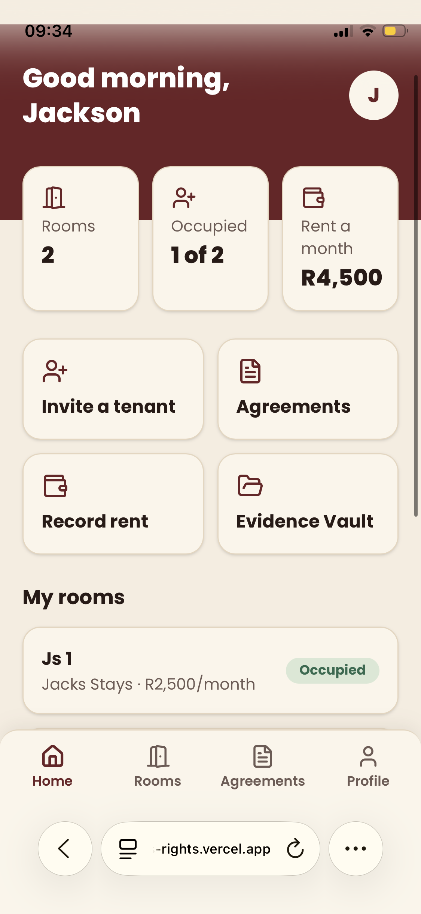
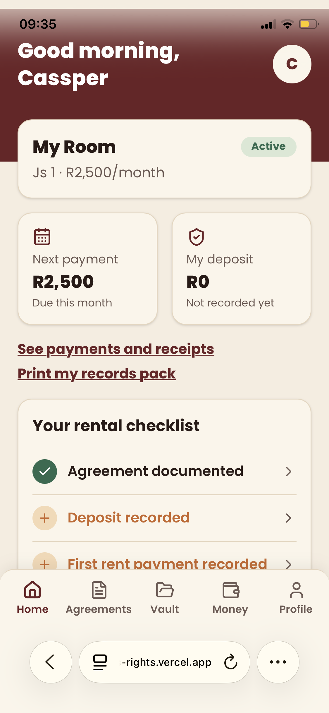
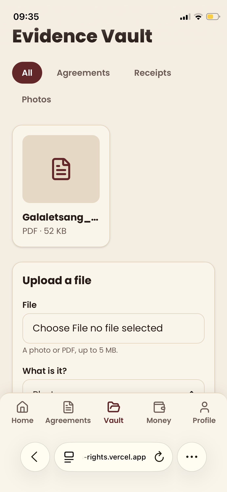
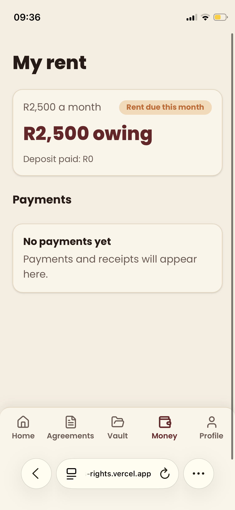
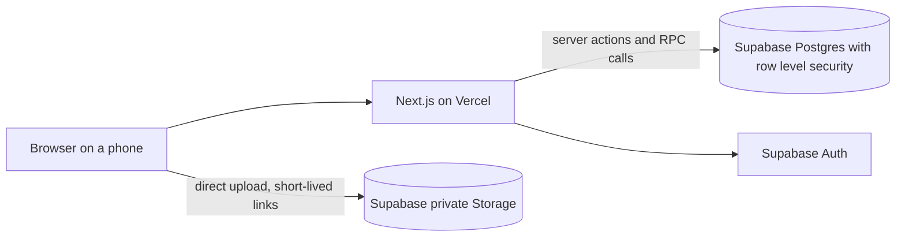

# Rooms&Rights

**Clear agreements and honest records for backroom rentals.**

A mobile-first web app that helps landlords and tenants of backyard and backroom rooms in South African townships keep a written agreement, the room's documents and a rent record in one place. The landlord pays a small monthly fee per room. The tenant uses it free.

- **Live app:** [https://rooms-rights.vercel.app/]
- **Designs (Stitch):** [https://stitch.google.com/projects/652628702472025550]
- **Demo video (Loom):** <ADD YOUR LOOM LINK>
- **Business plan:** [BUSINESS.md](BUSINESS.md)
- **Product requirements:** [docs/PRD.md](docs/PRD.md)
- **Implementation plan:** [IMPLEMENTATION_PLAN.md](IMPLEMENTATION_PLAN.md)
- **Designs and screen map:** [docs/designs](docs/designs/README.md)

## Test logins

| Role | Email | Password |
|---|---|---|
| Landlord | landlord@roomsandrights.demo | Landlord-Demo-2026 |
| Tenant | tenant@roomsandrights.demo | Tenant-Demo-2026 |
| Admin | admin@roomsandrights.demo | Admin-Demo-2026 |

These are demo accounts with sample data. Please do not enter real personal information.

## Screenshots

| Landlord dashboard | Agreement | Invite code |
|---|---|---|
|  |  |  |

| Tenant home | Evidence Vault | Rent ledger | Receipt |
|---|---|---|---|
|  |  |  |  |

## Features

- Email and password login with three roles: **landlord**, **tenant** and **admin** (the admin sees platform totals)
- Landlords manage properties and rooms from a dashboard
- Agreement builder for **written** and **recorded oral** agreements, printable or savable as PDF
- Invite a tenant by code, QR code or WhatsApp message. The tenant joins, reviews and accepts, and the agreement then locks
- Evidence Vault: photos and PDFs per room, with an "Only me" option for the landlord
- Rent and deposit ledger with numbered, printable receipts. Mistakes are voided with a reason, never deleted
- Tenant home shows what is owing and whether this month is paid

## Tech stack

| Layer | Choice |
|---|---|
| App | Next.js (App Router), TypeScript, Tailwind CSS |
| Database, auth, files | Supabase (Postgres, Auth, private Storage) |
| Hosting | Vercel |
| Tests | Vitest and React Testing Library, pgTAP (database permissions) |
| CI | GitHub Actions: lint, typecheck, test, build |

## Architecture



**How permissions work.** Security is enforced in the database, not only in the screens.

- Every table has row level security switched on.
- App users can only read tables. Every change goes through a database function that first checks who is asking.
- A user's role cannot be changed from the app, and nobody can sign up as admin.
- Accepted agreements are locked by a database trigger.
- Files live in a private bucket and are opened through links that expire after 10 minutes.

## Run it locally

```bash
git clone https://github.com/galaletsangmodise/Rooms-Rights.git
cd Rooms-Rights
pnpm install
cp .env.example .env.local   # then fill in your Supabase URL and anon key
pnpm dev
```

Open http://localhost:3000.

## Run the tests

```bash
pnpm test               # unit and component tests
pnpm lint
pnpm typecheck
pnpm build
pnpm supabase test db   # database permission tests (needs Docker)
```

CI runs lint, typecheck, test and build on every pull request.

## How this was built

Every feature followed the same loop: a GitHub Issue, a branch, tests written first, a pull request that closes the issue, and a squash merge once CI was green. See the closed [issues](../../issues) and [pull requests](../../pulls).

## Known issues and limits

- Demo only. The app gives legal information, not legal advice, and templates need review by a legal professional before real use
- Agreements cannot be edited once created. A draft can be cancelled and recreated
- An invite link opened while logged out does not remember the code (the WhatsApp message includes it)
- Files and payments cannot be edited or deleted. Payments can be voided
- Rent is counted in full from the move-in month, with no part-month adjustment
- No email or SMS notifications, and no phone-number login
- Database tests need Docker to run locally
- <ADD ANYTHING ELSE YOU DID NOT FINISH>

## Future work

Dispute centre and a printable tribunal pack, an admin library of ready-made clauses, notifications, and phone-number login.

## Author

Galaletsang Modise, Melsoft Academy, AI-Augmented Full Stack Developer Programme.
