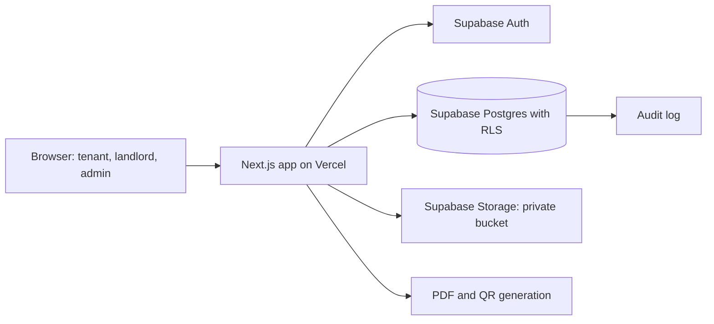

# Rooms&Rights

**Rent fairly. Live securely. Know your rights.**

Rooms&Rights helps backyard landlords and their tenants put their rental agreement in writing, keep every document and payment in one place, and settle disputes fairly before they become evictions or tribunal cases.


---

## Links

| | |
|---|---|
| **Live app** | `<ADD LIVE LINK>` |
| **Stitch designs** | [https://stitch.google.com/projects/652628702472025550] |
| **Loom pitch and demo** | `<ADD LOOM LINK>` |
| **Business plan** | [BUSINESS.md](./BUSINESS.md) |
| **Product requirements** | [docs/PRD.md](./docs/PRD.md) |
| **Implementation plan** | [IMPLEMENTATION_PLAN.md](./IMPLEMENTATION_PLAN.md) |
| **Designs** | [docs/designs/](./docs/designs/) |

---

## Test logins

These are real accounts on the live app, one per role.

| Role | Email | Password |
|---|---|---|
| Landlord | `<ADD>` | `<ADD>` |
| Tenant | `<ADD>` | `<ADD>` |
| Admin / paralegal | `<ADD>` | `<ADD>` |

**Try this flow:** log in as the landlord → open a property and room → create an agreement → copy the invite code → log in as the tenant → join with the code and accept → log back in as the landlord → record a payment → open the receipt as the tenant.

---

## The business

- **Problem:** Backroom rentals are informal. With no written terms or receipts, disputes, lost deposits and illegal lock-outs follow.
- **Customer:** Backyard landlords (they pay) and their tenants (free).
- **Solution:** Agreements, documents, rent ledger and receipts in one place, built for low-data phones and oral agreements too.
- **Model:** Monthly subscription per room, paid by the landlord.

Read the full plan in [BUSINESS.md](./BUSINESS.md).

---

## Features (Must)

1. **Login and roles:** landlord, tenant and admin, with permissions enforced in the database
2. **Property and room setup** with a landlord dashboard
3. **Agreement builder:** written agreement or recorded oral terms, PDF to print or share, invite by link, code or QR, tenant review and accept
4. **Evidence Vault:** documents and photos per room, with role-based access
5. **Rent and deposit ledger:** payments, numbered receipts, balances, and a tenant dashboard

**Planned:** Dispute Centre, Rental Housing Tribunal complaint pack, verified support directory, notices, WhatsApp reminders, more languages.

---

## Screenshots

| Mobile | Desktop |
|---|---|
| `<ADD screenshot: tenant dashboard>` | `<ADD screenshot: landlord dashboard>` |
| `<ADD screenshot: agreement builder>` | `<ADD screenshot: rent ledger>` |
| `<ADD screenshot: evidence vault>` | `<ADD screenshot: admin templates>` |

Store images in `docs/screenshots/` and link them here.

---

## Tech stack

| Layer | Choice |
|---|---|
| Frontend | Next.js, React, TypeScript, Tailwind CSS |
| Backend, database, auth, storage | Supabase (hosted Postgres, Auth, Storage, row-level security) |
| PDF and QR | Server-side PDF generation, `qrcode` |
| Testing | Vitest, React Testing Library, Supabase `test db` (pgTAP) for permissions, Playwright for end to end |
| CI/CD | GitHub Actions (lint, typecheck, tests, build), Vercel for hosting and preview deploys |

---

## Architecture



**Security model:** every table has row-level security with default deny. A user can only read or write rows tied to their own rooms. Tenants accept invites through a secure database function, so invite codes cannot be listed or guessed. Payments cannot be edited or deleted. Files are in a private bucket with short-lived signed URLs.

---

## Run locally

**Requirements:** Node 20+, pnpm, Docker (for local Supabase), Supabase CLI.

```bash
# 1. Clone and install
git clone https://github.com/<your-username>/<repo-name>.git
cd <repo-name>
pnpm install

# 2. Start local Supabase (Postgres, Auth, Storage)
supabase start

# 3. Create your env file and fill in the values printed by `supabase start`
cp .env.example .env.local

# 4. Apply migrations and seed data
supabase db reset

# 5. Run the app
pnpm dev
```

Open http://localhost:3000.

### Environment variables

| Name | Purpose |
|---|---|
| `NEXT_PUBLIC_SUPABASE_URL` | Supabase project URL |
| `NEXT_PUBLIC_SUPABASE_ANON_KEY` | Public anon key |
| `SUPABASE_SERVICE_ROLE_KEY` | Server only, never exposed to the browser |

Never commit `.env.local`.

---

## Run the tests

```bash
pnpm lint          # ESLint
pnpm typecheck     # TypeScript
pnpm test          # Unit and component tests (Vitest)
supabase test db   # Database permission (RLS) tests
pnpm e2e           # Playwright end-to-end tests
pnpm build         # Production build
```

CI runs lint, typecheck, tests and build on every pull request.

---

## Project workflow

Issues → branches → pull requests → squash merge. Branches use `feat/`, `fix/`, `chore/` and `docs/` prefixes. Commits follow Conventional Commits. `main` is protected and needs passing CI.

---

## Known issues

- Phase 2 features (disputes, tribunal pack, support directory) are designed but not built.
- Payment is recorded manually. Online payments are not included.
- Agreement templates need review by a practising attorney before wider launch.

---

## Legal notice

Rooms&Rights provides legal information and paperwork tools. It is not a law firm and does not give legal advice. For advice on a specific matter, speak to an admitted attorney, a community advice office or Legal Aid South Africa.

---

## Author

Galaletsang Modise — full-stack developer in training, Johannesburg.
GitHub: [github.com/galaletsangmodise](https://github.com/galaletsangmodise)